# Captures de Marc Familiar · emulador Android

Aquestes captures són **imatges reals de l'APK executada en un emulador Android**, no recreacions ni maquetes. L'emulador no conté dades personals ni fotos familiars.

Es generen per comprovar l'aspecte de la versió horitzontal de **1920 × 1200**. Quan la compilació automàtica estigui configurada, el procés les publicarà aquí.

## Portada «Avui»

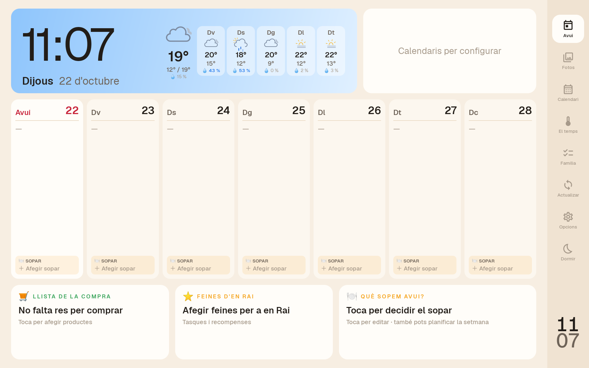

## Fotografies

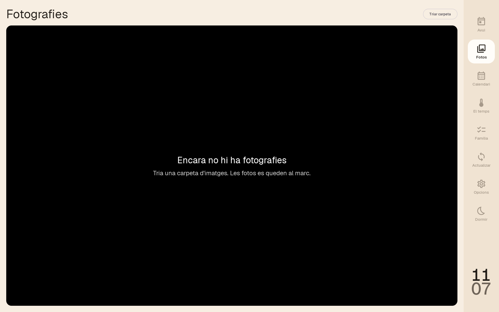

## Calendari

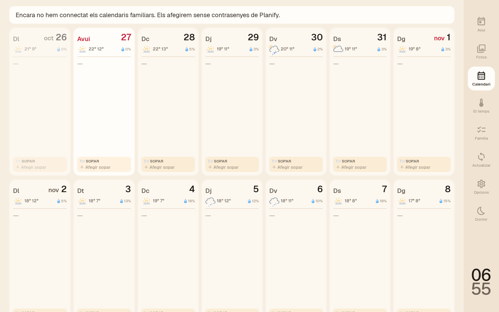

## El temps

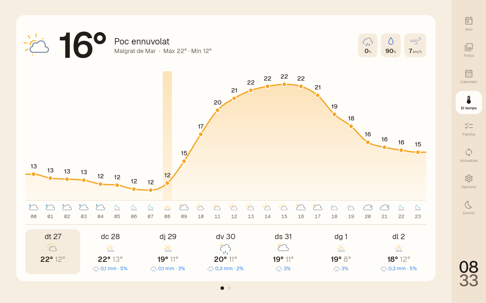

## Opcions

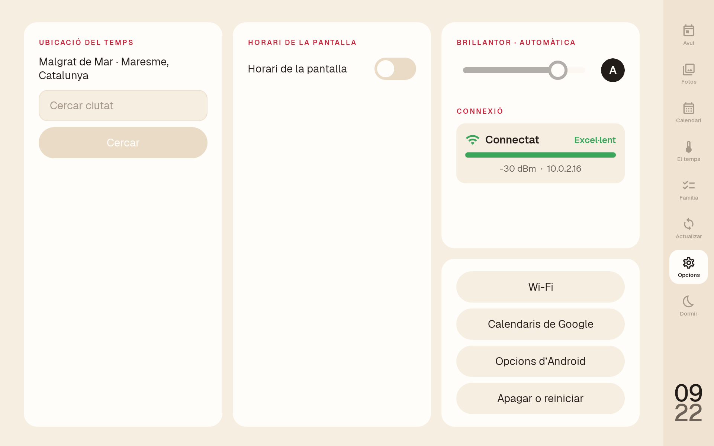

## Compra i tasques familiars

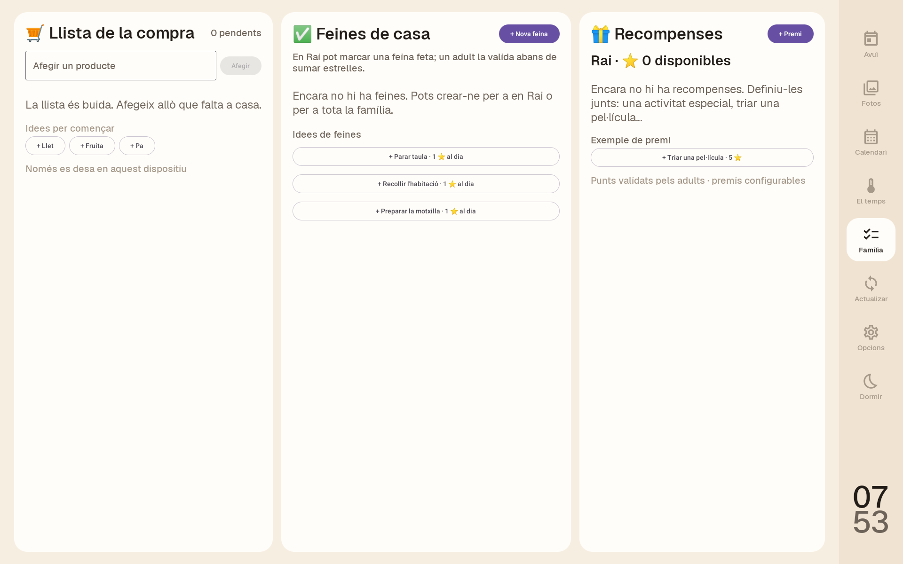

**Prova funcional a l'emulador (dades d'exemple, no reals):**

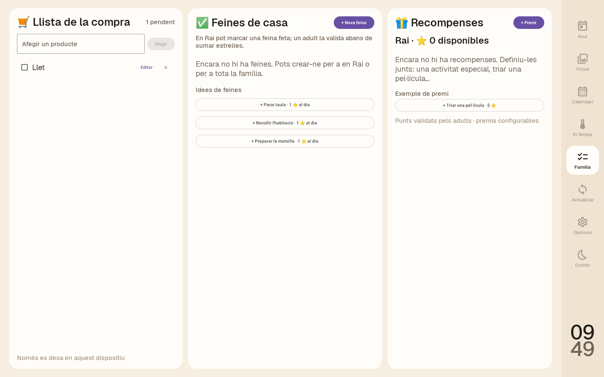

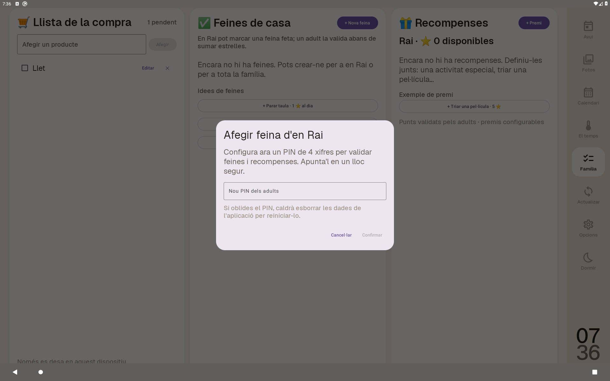

## Colors personalitzables de Google Calendar

Captures d'emulador Android 10, **amb dos calendaris ficticis** («Rai» i «Família»).
No contenen esdeveniments reals ni enllaços iCal privats.

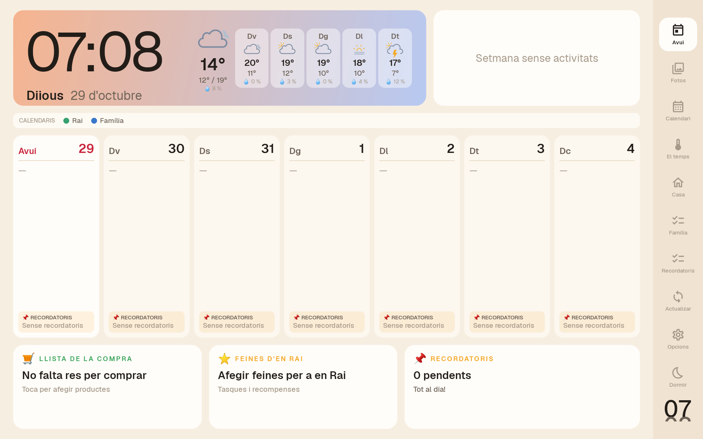

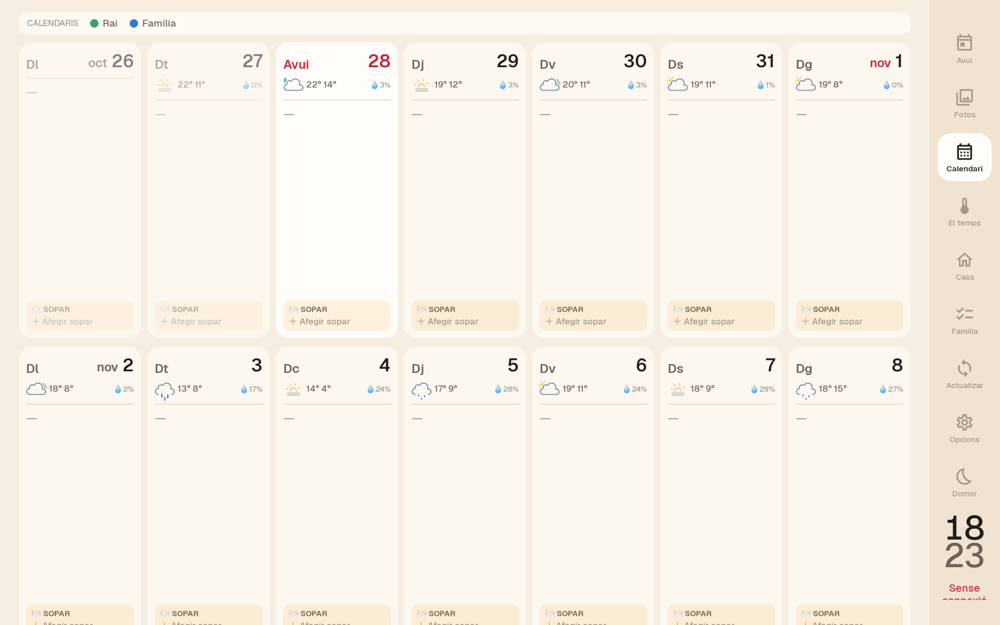

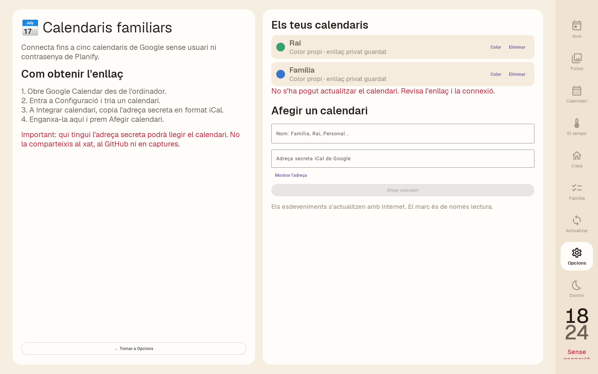

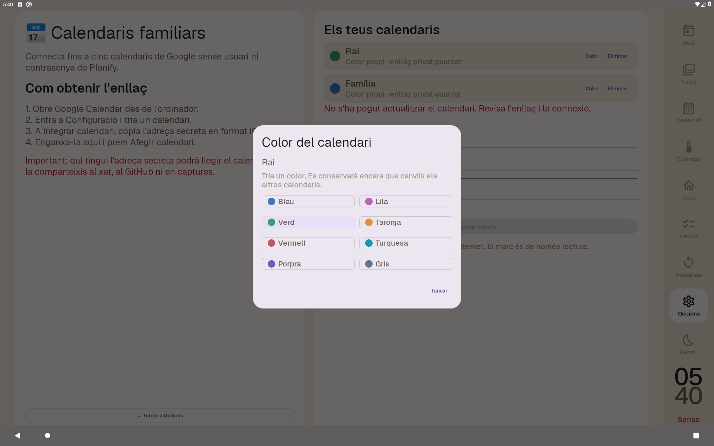

[Guia de colors de Google Calendar](../COLORS-CALENDARIS.md).

## Meteorologia i Google Calendar

La ubicació meteorològica inicial és **Malgrat de Mar**. La configuració de Google Calendar es mostra sempre **sense URL privades** en aquestes captures.

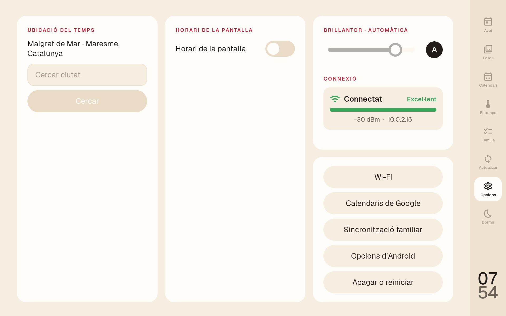

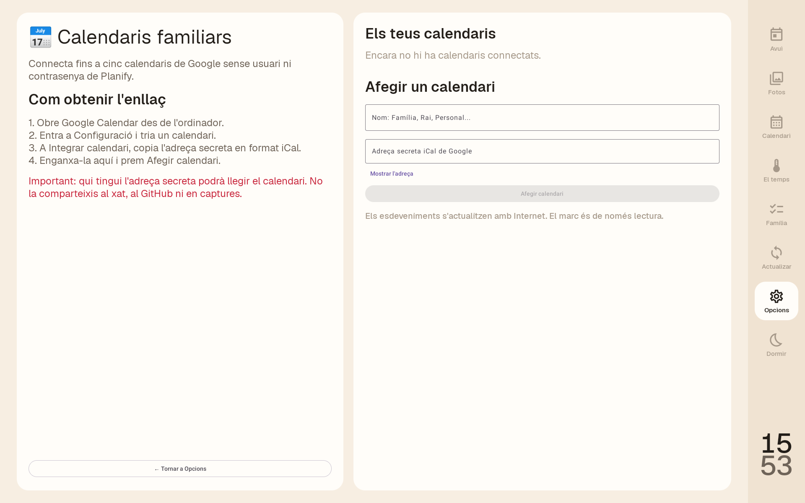

## Sincronització familiar (compra i sopars)

Pantalla inicial **sense dades personals ni clau configurada**:

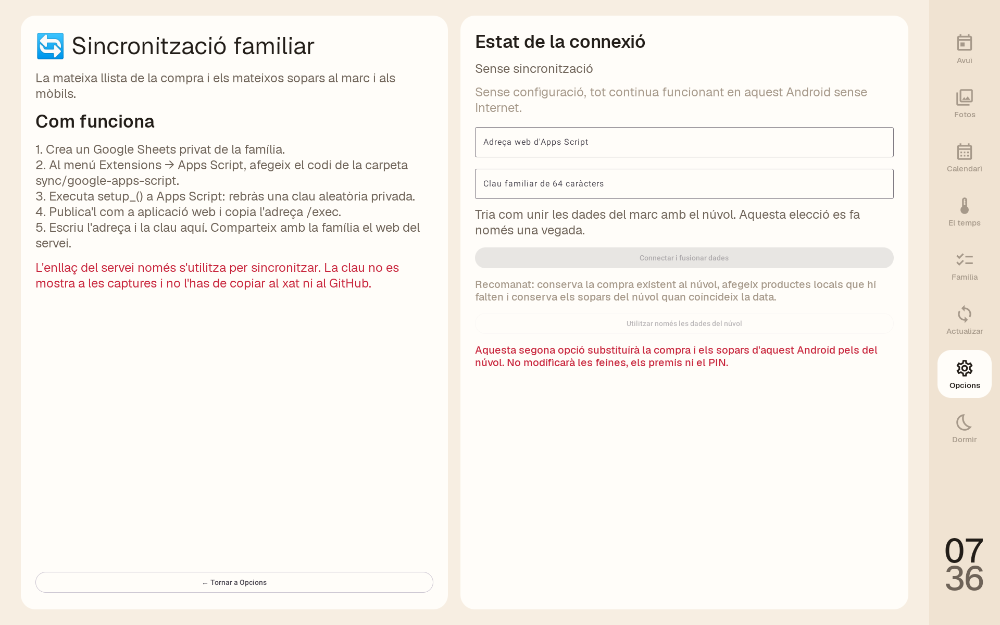

La configuració s'explica a [Sincronització familiar](../SINCRONITZACIO-FAMILIAR.md). Encara s'ha de desplegar un Apps Script privat per activar les dades compartides.

## Sopars

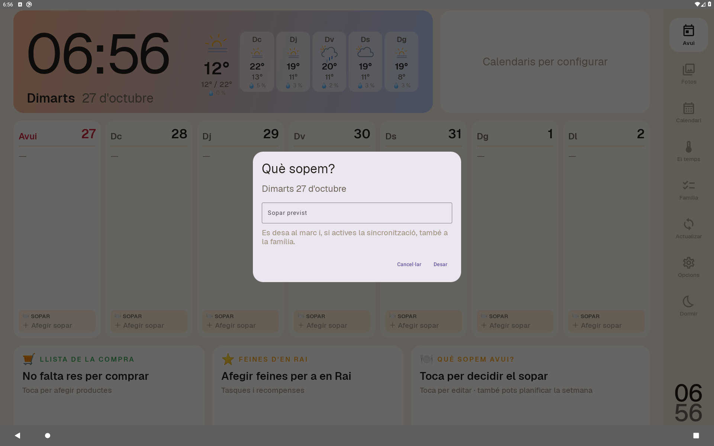

**Nota:** en un emulador acabat de crear, no apareixen esdeveniments, fotografies ni previsió fins que s'hi introdueixen les dades corresponents. Aquesta és una previsualització del disseny, no una prova de la integració amb els serveis personals.
